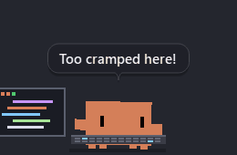

<p align="center"></p>

# I LOVE CLAWD

**A desktop pet for Claude Code.** 100% vibe-coded: every line was written by AI (Claude Code), the human only gave vibes and feedback.

A tiny pixel-art crab that lives on top of your windows (Windows 10/11) and reacts to what
[Claude Code](https://claude.com/claude-code) is doing — so you can look at something else while Claude works.

| Claude is… | Clawd… |
|---|---|
| working | sits at a tiny computer and types |
| done | hops and throws a **!** (plus a short sound) |
| waiting for you | shows a **?** until you answer |

He is also just fun to have around: grab him, throw him, hang him by a claw, give him a cookie.
He plays along when you launch a game (and stays out of your way elsewhere), and can show the charge of
your gamepad, laptop or headset when you hover the little gadgets next to him.

> [!NOTE]
> **Fullscreen games:** Clawd is a normal always-on-top window. In some games running in *exclusive* fullscreen,
> Windows lets the game draw straight to the screen and no window can appear above it — Clawd is then detected
> but not visible. If that happens, switch the game to **windowed / borderless (windowed-fullscreen)** mode
> (Minecraft: not F11 fullscreen, or a "Borderless Fullscreen" mod). It depends on the game and graphics drivers; please open an issue with the game name.
> Windows may also show a SmartScreen warning for the unsigned `Clawd.exe` — "More info" → "Run anyway".

## Install

1. Download **`Clawd.exe`** from the [latest release](../../releases/latest) and run it. No installer, no Python needed.
2. On first launch Clawd asks whether to connect to Claude Code. Say **Yes** (it adds four small hooks to
   `~/.claude/settings.json`; a backup is saved next to it). You can undo it any time from the tray menu.
3. Optional: tray menu → **Run at startup**.

Everything lives in the tray icon / right-click menu: cookie, sound, game mode, gadgets, startup, **language**.
Languages: English, Русский, Українська, Deutsch, Español, Français, Português, 中文, 日本語 — picked automatically from Windows, switchable in the menu.

## Controls

- **Drag / throw** him with the mouse; grab any point and he dangles from it. Click to poke.
- **Right-click** — the menu. **Ctrl+Alt+G** — game mode on/off. **Ctrl+Alt+arrows** — move him in a game (the mouse is captured there).

## Game mode

When a game is in front, Clawd walks to a spot you choose (drag him, he remembers it) and plays along with a
gamepad, reacting to how busy your hands are. Detected: games in Steam/Epic/Riot/GOG/Xbox folders, Minecraft,
and any window using Direct3D/Vulkan/OpenGL that covers the screen. Add your own exe names to `game_exes`
in `%APPDATA%\Clawd\config.json`. See the warning above about exclusive fullscreen.

## Battery readout

Hover the gadgets (enable them in the menu). Charge is shown only for what is connected: Xbox-style gamepads (XInput),
laptop battery, Bluetooth devices that report it, and HyperX Cloud III Wireless headsets (via `hidapi`).

## Run from source / build

```powershell
pip install -r requirements.txt
python clawd.py            # or run.bat
.\build.bat                # -> dist\Clawd.exe (needs pyinstaller + pillow)
```

Layout: `clawd.py` (the pet), `i18n.py` (translations — add a language by copying the `en` block),
`paths.py` (data folder, hooks installer, autostart), `gadgets.py` (device icons and polling), `hook.py` (script form of the hook).
Runtime data (state/config) is in `%APPDATA%\Clawd`. Hook CLI: `Clawd.exe --hook working|done|attention|idle`.

## Contributing

Issues and PRs welcome — especially translations, new idle animations, and game detection fixes.

## Vibe-coded disclaimer

This whole project was vibe-coded with Claude Code. It works on my machine and probably on yours, but expect rough edges — PRs welcome.

## License

[MIT](LICENSE)
